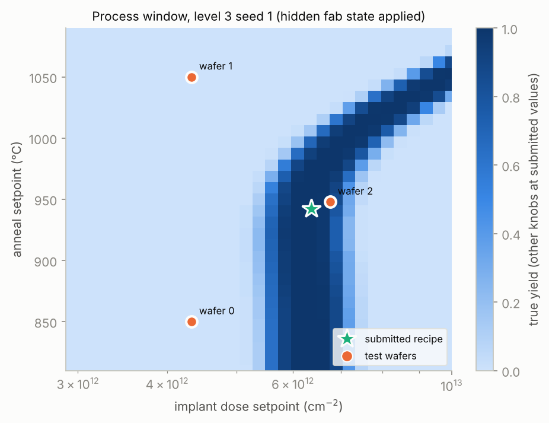
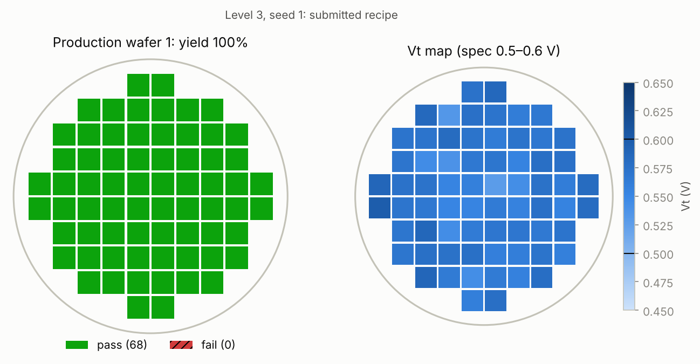
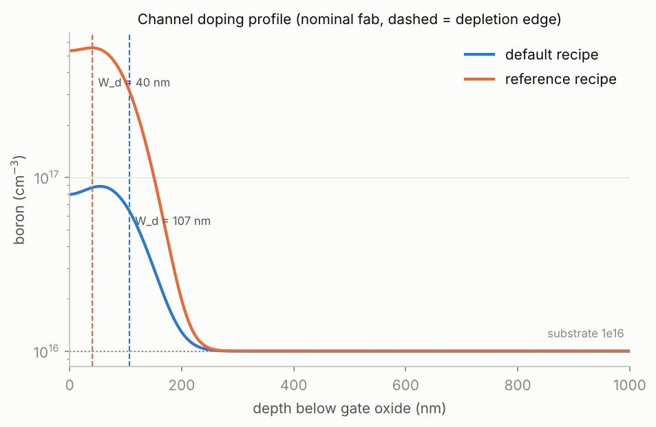

# Fab Yield

**An RL environment where an agent runs a simulated chip fab line and has to
tune the process recipe so that transistors meet spec.** Test wafers cost
budget, measurements are noisy, the knobs are physically coupled, and in the
hardest level the fab's own tools are miscalibrated in ways the agent has to
detect from its data.

```bash
pip install -e ".[dev]"        # numpy (+ matplotlib, pytest for plots/tests)
python -m fab_yield.eval       # one command: every baseline + reference, levels 1-3, seeds 0-2
```

Everything is seeded and deterministic: the same command prints the same
numbers on any machine.

---

## 1. Why this setting

Process engineering is a real, high-value, niche workflow that frontier
agents rarely see done well. It needs exactly the skills agents tend to skip:

* **Computing with physics, not reciting it.** Every equation is in the docs,
  but the useful numbers only come out of evaluating them (Deal-Grove oxide
  growth, Arrhenius diffusion, a depletion integral over a non-uniform doping
  profile).
* **Handling coupled parameters.** The gate oxidation sets oxide thickness
  *and* adds thermal budget that diffuses the channel implant. Turning one knob
  at a time chases its own tail.
* **Statistics under a cost.** Single-die readings are noisy and dies really
  do differ. Knowing how many dies to measure, and when to stop, is part of
  the task.
* **Model calibration (level 3).** Furnaces run hotter or colder than their
  setpoints and the implanter's dose is off by a few percent. An agent that
  trusts setpoints submits a recipe that lands outside the narrow process
  window.
* **Robustness, not just hitting the mean.** Score is yield over 1020
  production dies with run-to-run and die-to-die variation, so recipes have to
  sit where the device is insensitive to that variation.

The process window is a narrow, curved ridge in a 7-D space (see the figure
below). A reference solver that calibrates first and then optimises for
robustness reliably lands in the middle of it.



---

## 2. The physics: four layers

Every equation lives in `fab_yield/physics.py` and `fab_yield/simulator.py`,
and the agent gets the same equations through `read_docs` (`fab_yield/docs/`).
All models are textbook-standard (references at the bottom).

| Layer | What it models | Models used |
|---|---|---|
| **1. Process** (recipe → structure) | Boron Vt-adjust implant → activation anneal → dry gate oxidation → n+ poly gate | Gaussian implant with tabulated Rp/ΔRp [Gibbons]; Arrhenius boron diffusivity D = 0.76·exp(−3.46 eV/kT), σ² = ΔRp² + 2·Dt where **both** furnace steps add Dt [Plummer]; Deal-Grove x² + Ax = B(t+τ) for dry (100) Si [Deal & Grove]; silicon consumed by oxidation removes surface dopant |
| **2. Device** (structure → electrical) | Vt, Ion, Ioff of a W = 10 µm NMOS at Vdd = 3.3 V | Depletion approximation solved numerically on the non-uniform profile (2φ_F condition) → Vt_long [Tsividis, Sze]; short-channel roll-off + DIBL with characteristic length l_t = √(ε_si·t_ox·W_d/ε_ox) [Liu et al.]; subthreshold swing S = ln10·kT/q·(1 + C_dep/C_ox) → Ioff; velocity-saturation Ion with mobility degradation [Hu]; Caughey-Thomas mobility for sheet resistance |
| **3. Variation** (one device → a wafer) | 68 dies on a 100 mm wafer | Run-to-run: furnace ±1 °C, dose ±1 %. Die-to-die: dose 1.5 %, t_ox 1 %, L 0.02 µm, Q_f 1e10 cm⁻². Radial t_ox and L gradients. **Hidden per seed (level 3):** anneal-furnace offset (8–20 °C), oxidation-furnace offset (5–12 °C), implanter dose factor (±4–10 %), radial oxide gradient |
| **4. Metrology** (what the agent sees) | Noisy, costed measurements only, never true values | Ellipsometer (t_ox, ±0.15 nm), four-point probe (sheet resistance on a monitor wafer, ±1 %), electrical test (Vt ±3 mV, Ion ±0.5 %, Ioff ±0.03 dec) |

The simulator runs in about 5 ms per wafer, using pure numpy and no TCAD.

---

## 3. The parameters the agent tunes

| Knob | Unit | Range | Default | What it does |
|---|---|---|---|---|
| `implant_dose` | cm⁻² | 1e11 – 1e13 | 1e12 | More boron in the channel: Vt goes up, Ioff down, Ion down |
| `implant_energy` | keV | 5 – 100 | 20 | Implant depth Rp. Deeper puts less dose inside the depletion region, which lowers Vt |
| `anneal_temp` | °C | 800 – 1100 | 950 | Diffusion is Arrhenius, roughly +25–30 % D per +10 °C. Spreads the implant and lowers Vt |
| `anneal_time` | min | 1 – 120 | 30 | Diffusion length goes as √(Dt) |
| `ox_temp` | °C | 800 – 1050 | 900 | Oxide growth rate **and** extra thermal budget |
| `ox_time` | min | 5 – 180 | 45 | Oxide thickness (C_ox, reliability) **and** extra thermal budget |
| `gate_length` | µm | 0.25 – 2.0 | 1.0 | Shorter gives more Ion, but Vt roll-off, higher Ioff and more sensitivity to L variation |

**Spec per die:** 0.50 V ≤ Vt ≤ 0.60 V, Ion ≥ 3.5 mA, Ioff ≤ 20 pA,
t_ox ≥ 7 nm (gate-oxide reliability). The default recipe yields 0 %.

---

## 4. Difficulty levels

| Level | Free knobs | Fab | Budget | What it tests |
|---|---|---|---|---|
| **L1 single knob** | `implant_dose` only | calibrated, half noise | 6 | Sanity check: invert one monotone relation |
| **L2 coupled knobs** | all 7 | calibrated | 20 | Navigate a narrow, curved, coupled process window |
| **L3 miscalibrated fab** | all 7 | hidden furnace/implanter offsets | 20 | Design informative experiments, calibrate the model, then optimise robustly |
| L4 full yield *(planned)* | all 7 | + larger variation | | Centring in the window matters more than hitting the mean |
| L5 production drift *(planned)* | all 7 | tools drift during the lot | | Mid-run corrections |

---

## 5. Agent interface

Four tools, with JSON schemas in `fab_yield/tools.py`:

| Tool | Cost | Returns |
|---|---|---|
| `read_docs(topic)` | free | Documentation: `index`, `process_flow`, `oxidation`, `implant`, `diffusion`, `device`, `variation`, `metrology`, `scoring` |
| `run_wafer(recipe)` | 1.0 | A `wafer_id`, no data |
| `measure(wafer_id, tool, dies)` | 0.02/die electrical, 0.005/site ellipsometer or four-point probe | Per-die readings with x/y coordinates |
| `submit_recipe(recipe)` | free | Ends the episode; runs the 15-wafer production lot |

From Python:

```python
from fab_yield.env import FabEnv
env = FabEnv(level=3, seed=0)
print(env.task_prompt())
env.step({"tool": "run_wafer", "args": {"recipe": {"implant_dose": 4e12, "gate_length": 0.5}}})
env.step({"tool": "measure", "args": {"wafer_id": 0, "tool": "electrical", "dies": 10}})
env.step({"tool": "submit_recipe", "args": {"recipe": {...}}})
print(env.result())
```

For any harness, a JSON-lines tool server reads one action per line on
stdin and writes one result per line on stdout:

```bash
python -m fab_yield.cli --level 3 --seed 0 --log run.json
```

---

## 6. Reward and reward integrity

```
lot_yield = fraction of 1020 fresh production dies (15 wafers) meeting every spec
score     = max(0, lot_yield − 0.005 × budget_spent)
```

| Exploit attempt | Why it fails |
|---|---|
| Do nothing / never submit | Score 0 by construction |
| Stop early (submit the default) | The default recipe yields 0 % (tested on all levels and seeds) |
| Extreme or out-of-range knobs | Rejected with an error at no cost; all 128 corners of the knob box yield 0 (tested) |
| NaN, strings, booleans, unknown knobs, changing fixed knobs | Rejected (tested) |
| Overfitting to test wafers | Production lot uses independent random streams; only the recipe carries over |
| Submitting twice, acting after submit | Episode ends at the first submission |
| Endless tool calls | Hard cap of 100 actions, then score 0 if nothing was submitted |
| Reading the hidden state | Lives only in the simulator, never in any observation (tested) |

The yield term dominates. A perfect recipe found with 4 wafers scores about
0.98, so experimenting well always beats guessing.

---

## 7. Baselines and reference (reproduce with `python -m fab_yield.eval`)

* **do_nothing**: no actions.
* **stop_early**: submits the default recipe immediately.
* **open_loop_physics**: optimises with the documented model, *assuming a
  calibrated fab*, spends nothing and submits. This is the ceiling for
  "knows the physics, never measures".
* **reference**: on L1/L2 it is the same as open-loop, because the fab is
  calibrated and wafers only cost money. On L3 it runs two short-loop monitor
  wafers (cold anneal to isolate the dose factor, hot anneal to expose the
  anneal offset), fits the hidden offsets by least squares on wafer means, and
  optimises yield by Monte Carlo under the remaining calibration uncertainty.
  It then runs one verification wafer, refits, polishes and submits. It
  uses only `env.step`, never the hidden state.

Results (seeds 0–2, deterministic, about 3 minutes on a laptop):

| level | policy | mean score | min | max | mean yield | mean budget |
|---|---|---|---|---|---|---|
| L1 | do_nothing | 0.000 | 0.000 | 0.000 | 0.000 | 0.00 |
| L1 | stop_early | 0.000 | 0.000 | 0.000 | 0.000 | 0.00 |
| L1 | open_loop_physics | 1.000 | 1.000 | 1.000 | 1.000 | 0.00 |
| L1 | reference | 1.000 | 1.000 | 1.000 | 1.000 | 0.00 |
| L2 | do_nothing | 0.000 | 0.000 | 0.000 | 0.000 | 0.00 |
| L2 | stop_early | 0.000 | 0.000 | 0.000 | 0.000 | 0.00 |
| L2 | open_loop_physics | 0.999 | 0.999 | 1.000 | 0.999 | 0.00 |
| L2 | reference | 0.999 | 0.999 | 1.000 | 0.999 | 0.00 |
| L3 | do_nothing | 0.000 | 0.000 | 0.000 | 0.000 | 0.00 |
| L3 | stop_early | 0.000 | 0.000 | 0.000 | 0.000 | 0.00 |
| L3 | open_loop_physics | 0.329 | 0.000 | 0.988 | 0.329 | 0.00 |
| L3 | reference | 0.980 | 0.979 | 0.980 | 1.000 | 3.93 |

On L3, open-loop physics scores 0 on two of three seeds: knowing the equations without calibrating the fab misses the window. The reference recovers the offsets (for example, a fitted anneal offset of −13.0 °C against a true −13.3 °C) and scores 0.98 on every seed.

Frontier-agent runs are the next step (see roadmap).

---

## 8. Figures

`python -m fab_yield.plots --level 3 --seed 1` writes the following to
`results/figures/`:

* `wafer_map_*.png`: pass/fail and Vt maps of a production wafer
* `process_window_*.png`: true yield over dose × anneal setpoint, with every
  test wafer and the submitted recipe overlaid
* `doping_profile_*.png`: channel boron profile and depletion edge, default
  vs submitted




---

## 9. Repository layout

```
fab_yield/
  physics.py     process + device equations (layers 1-2)
  simulator.py   knobs, variation, wafer layout, metrology (layers 3-4)
  env.py         FabEnv: tools, levels, budget, scoring
  reference.py   calibration + robust-optimisation reference solver
  baselines.py   do_nothing, stop_early, open_loop_physics
  eval.py        one-command evaluation -> results/results.json
  plots.py       figures
  tools.py       JSON tool schemas for LLM harnesses
  cli.py         JSON-lines tool server
  docs/*.md      what the agent reads via read_docs
tests/           physics sanity, determinism, reward-integrity tests
```

## 10. Roadmap

1. LLM agent runner on the organisers' harness, with three frontier runs per
   level. Gap plots: yield vs. budget spent, experiment path on the process
   window.
2. Levels L4 (larger variation, centring) and L5 (in-lot drift with
   corrections).
3. Failure-mode taxonomy from agent transcripts: one-knob-at-a-time tuning,
   trusting single readings, ignoring calibration, never computing the
   depletion integral.
4. Stretch: fine-tune a small model on reference and filtered agent
   trajectories.

## References

* B. E. Deal, A. S. Grove, "General relationship for the thermal oxidation of silicon", *J. Appl. Phys.* 36, 3770 (1965).
* J. D. Plummer, M. D. Deal, P. B. Griffin, *Silicon VLSI Technology*, Prentice Hall (2000): oxidation constants (ch. 6), boron diffusivity (ch. 7), implantation (ch. 8).
* J. F. Gibbons, W. S. Johnson, S. W. Mylroie, *Projected Range Statistics*, 2nd ed. (1975).
* S. M. Sze, K. K. Ng, *Physics of Semiconductor Devices*, 3rd ed., Wiley (2007).
* Y. Tsividis, C. McAndrew, *Operation and Modeling of the MOS Transistor*, 3rd ed., OUP (2011).
* C. Hu, *Modern Semiconductor Devices for Integrated Circuits*, Pearson (2010).
* Z.-H. Liu et al., "Threshold voltage model for deep-submicrometer MOSFETs", *IEEE TED* 40, 86 (1993).
* D. M. Caughey, R. E. Thomas, "Carrier mobilities in silicon empirically related to doping and field", *Proc. IEEE* 55, 2192 (1967).

**Simplifications, stated up front:** 1-D intrinsic diffusion (no TED, no
concentration-dependent D); thin-oxide Deal-Grove regime approximated by a
1.5 nm native oxide; long-channel Vt plus an analytic roll-off; a single
device type. These keep the simulator fast and auditable, and the agent's
decisions are the same ones a process engineer makes.
